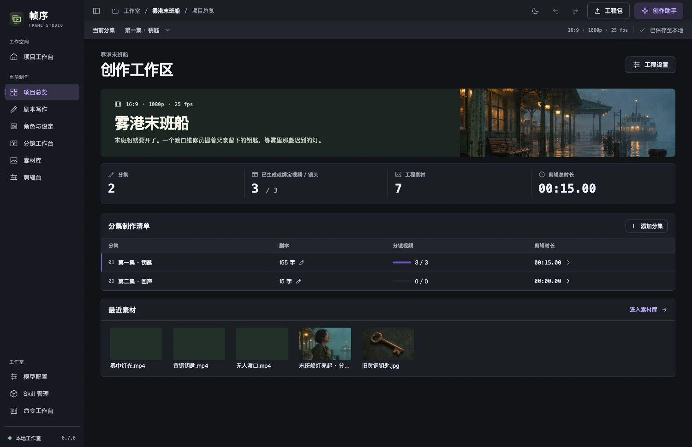
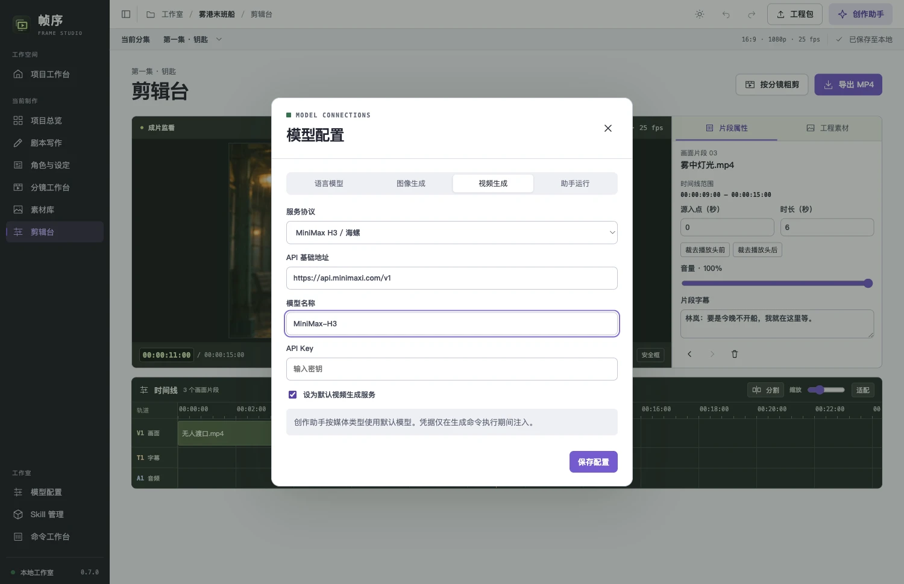
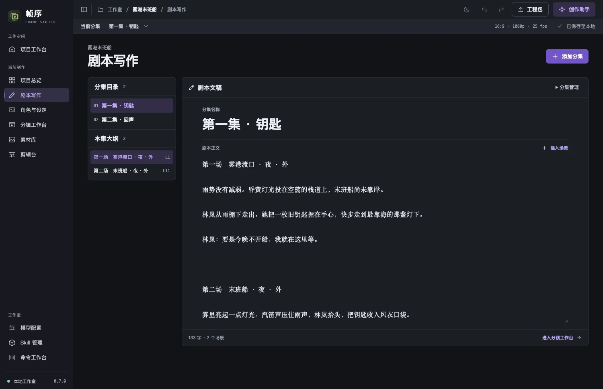
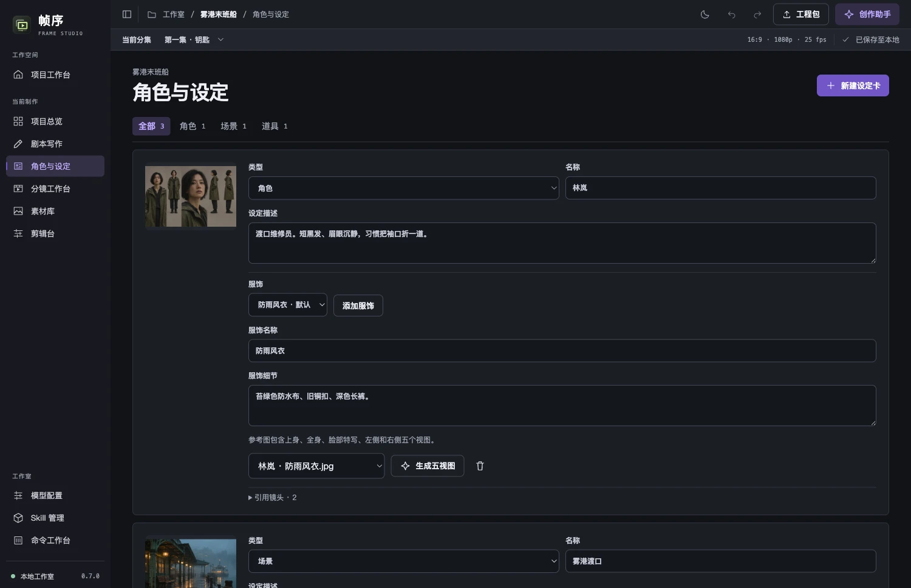
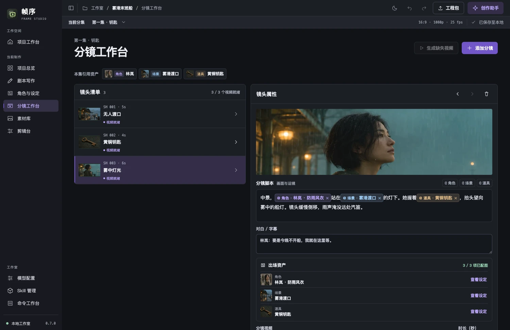
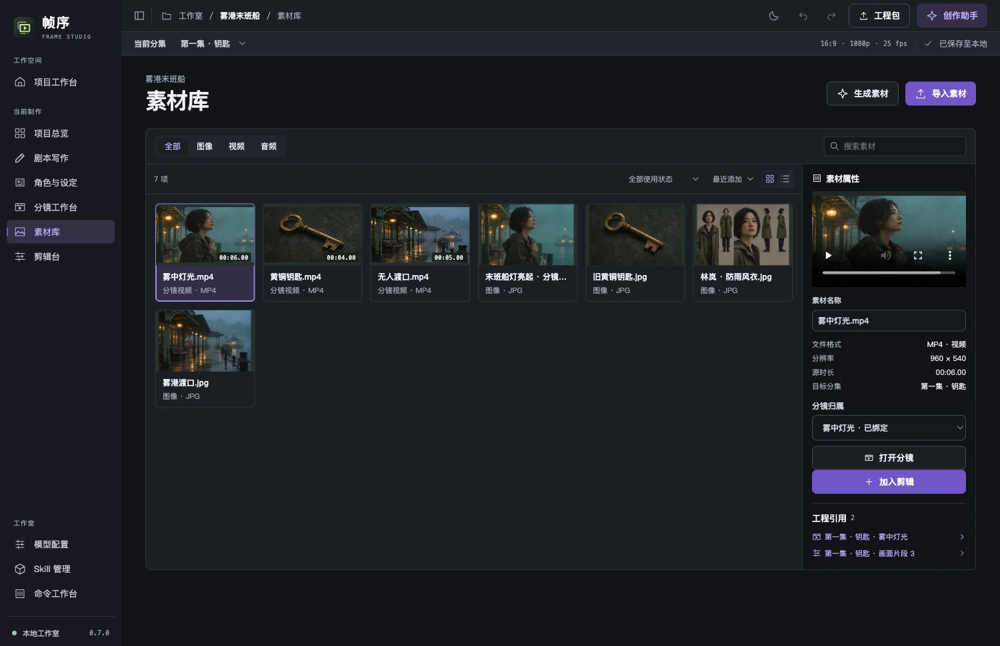
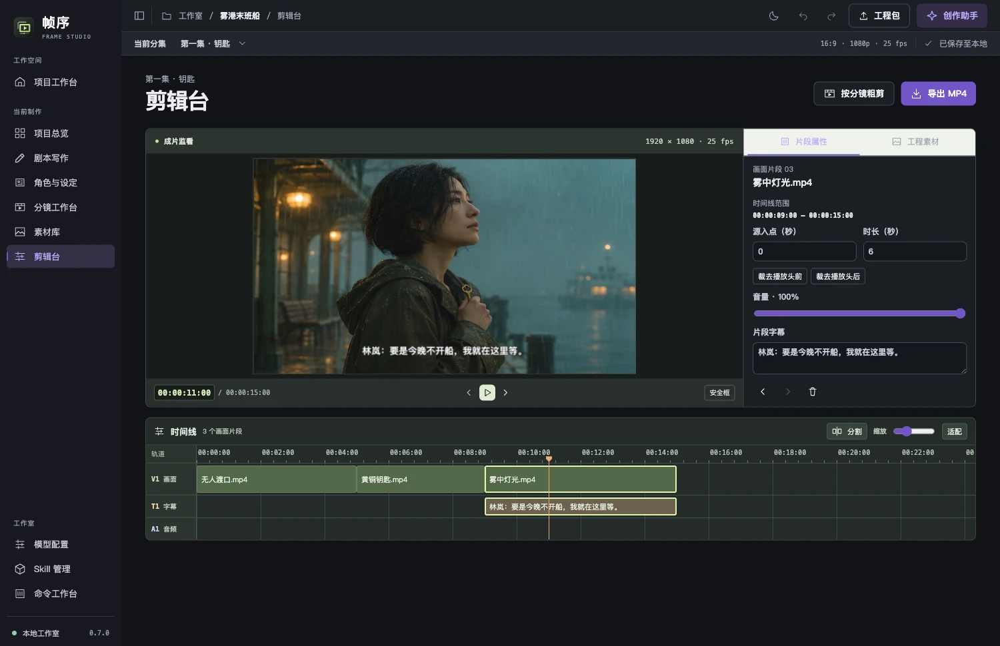
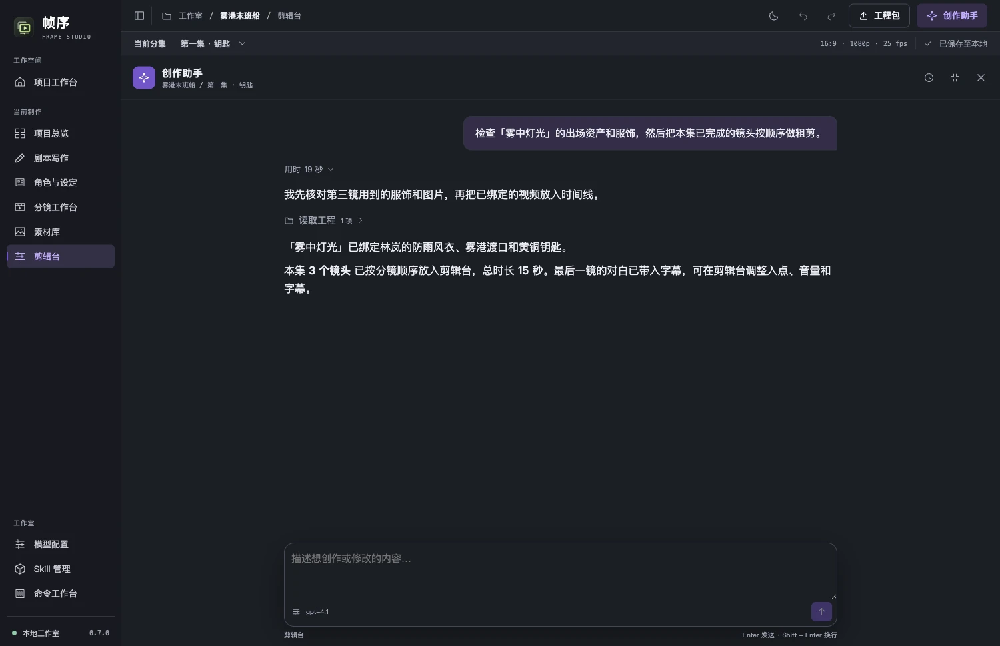
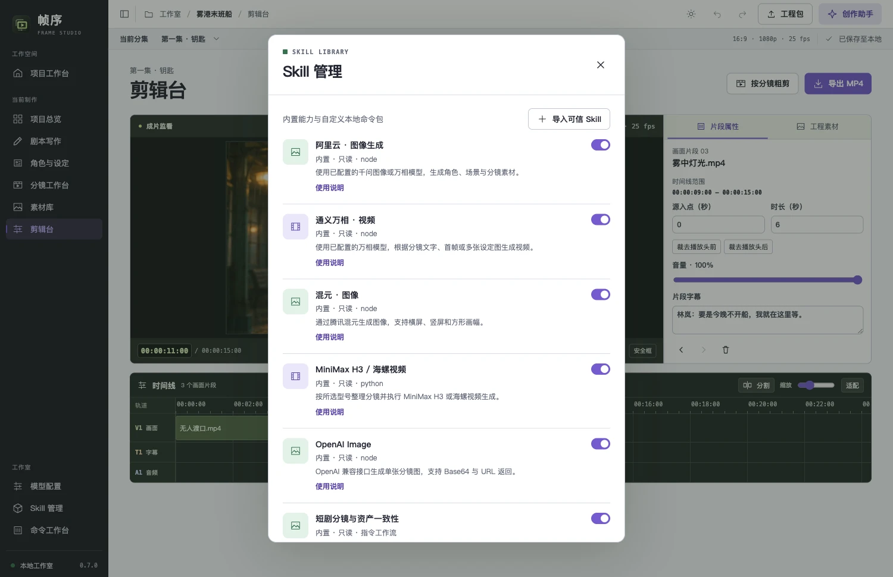

<div align="center">
  
  <h1>帧序 · Frame Studio</h1>
  <p>把剧本、角色、分镜和剪辑放进同一个本地工程。</p>
  <p>
    <a href="#安装与配置">安装与配置</a> ·
    <a href="#从分镜到成片">从分镜到成片</a> ·
    <a href="#使用创作助手">创作助手</a> ·
    <a href="#用-skill-扩展工作流">Skill 扩展</a> ·
    <a href="#开发与打包">开发与打包</a>
  </p>
</div>



帧序是一个本地优先的 AI 短剧桌面工作室。编剧、角色服饰、分镜、图像和视频生成、剪辑以及 MP4 导出都在同一个工程内完成。界面使用 Electron、Vite 和 Vue 3.6 Vapor，工程自动保存到本地。模型请求由应用直接发往你配置的服务。

截图是虚构短剧「雾港末班船」在真实 Electron 窗口中的演示。画面用示例素材搭建，助手截图展示示例对话与执行记录。

## 安装与配置

| 系统    | 安装包      | 使用方式                                                                         |
| ------- | ----------- | -------------------------------------------------------------------------------- |
| macOS   | `.dmg`      | 从 GitHub Release 下载匹配芯片架构的构建，打开磁盘映像后把应用拖到「应用程序」。 |
| Windows | `.exe`      | 运行 NSIS 安装程序。                                                             |
| Linux   | `.AppImage` | 赋予执行权限后启动，或直接从源码运行。                                           |

发布安装包前可以先用[源码启动](#开发与打包)。已打包应用随附 Node、CPython 和 FFmpeg。编辑、导入本地素材及剪辑可离线使用。调用在线模型时需要网络和该服务的凭据。

### 1. 新建工程

在「项目工作台」点「新建项目」，输入名称并选择本地父目录。应用会创建独立的 `Frame-项目名称` 目录。短视频可选 9:16，横屏短剧可选 16:9，也可以选 1:1。工程设置中还可调整 720p 或 1080p、24/25/30 fps 和项目梗概。

### 2. 配置语言模型和媒体服务

打开「模型配置」，分别完成下面几项。**视频生成会先调用语言模型整理本镜提示词**，所以使用内置视频 Skill 时也需要配置语言模型。

| 标签     | 填什么                                                                                                         | 做什么                                                                                                                             |
| -------- | -------------------------------------------------------------------------------------------------------------- | ---------------------------------------------------------------------------------------------------------------------------------- |
| 语言模型 | 选择 OpenAI Chat、OpenAI Responses 或 Anthropic Messages，填基础地址、模型名和 API Key，再设为助手使用的协议。 | 驱动创作助手，也为视频生成整理提示词。                                                                                             |
| 图像生成 | 配置 OpenAI 兼容图像、阿里云千问/万相或腾讯混元。混元另填 SecretId 和地域。                                    | 生成角色五视图、场景图、道具图与分镜底图。                                                                                         |
| 视频生成 | 配置 MiniMax 或阿里云万相。按服务填写准确的模型名，并将所需服务设为默认。                                      | 按实际参考模式生成镜头片段。                                                                                                       |
| 助手运行 | 设置上下文压缩阈值、首次响应超时和命令审批策略。                                                               | 默认 270,000 tokens、300 秒、独立审核后帮我批准命令。可切换请求批准或完全访问权限。收到响应头后持续读取 SSE，无响应最多重试 5 次。 |

API 基础地址填写服务提供的前缀。模型名使用服务商控制台或接入网关给出的 ID。视频需要同时使用多张角色、场景和道具图时，先确认型号支持参考生视频。例如用于本地多图的选项有 `MiniMax-H3` 与 `wan3.0-video`。海螺单首帧模式适合用一张已构图的分镜底图启动动画。



## 从分镜到成片

### 1. 写剧本和分集

打开「剧本写作」，添加分集和场次，在正文里分别记录地点、动作与对白。剧本阶段可以写整场戏。到分镜阶段，把每句对白和实际出场资产拆到所属镜头。



### 2. 建立角色、服饰、场景和道具

在「角色与设定」新建卡片。角色卡填写脸、体型、发型等稳定特征。不同服饰单独记录，并各自绑定一张参考图。选中服饰并点「设为默认」后，只引用该角色的镜头就会使用这一套。

点击「生成五视图」可生成一张设定图，包含正面上身、正面全身、面部特写、左侧全身和右侧全身。参考图应使用空白底，五格统一同一人物和同一套衣饰。可直接绑定素材库已有图片。场景卡记录空间、地标和光线，道具卡记录形状与材质。



### 3. 写分镜，核对出场资产

打开「分镜工作台」，点「添加分镜」，填写镜头标题、画面与运镜、对白和时长。在画面脚本输入 `@` 搜索资产，用上下键选择并回车插入。选服饰项可以固定到某套衣装，选择角色默认项则会随角色的默认服饰更新。

例如「雾中灯光」的画面可以写「中景，@林岚 · 防雨风衣站在 @雾港渡口的灯下，握着 @黄铜钥匙，抬头望向雾中的船灯」。把「林岚：要是今晚不开船，我就在这里等。」写在这一镜的对白栏。

生成前查看「出场资产」。缺图时可原地导入或绑定。分镜参考图用来表达这一镜的构图，服饰图用来表达角色外观，各有自己的位置。黑场或抽象过渡可以明确勾选「此镜头无需出场资产」。



### 4. 生成镜头与整理素材

- 只做一镜时用「生成分镜视频」。检查服务、时长和图像数量后开始。
- 要补齐系列镜头时用「生成缺失视频」。批量任务按选中的镜头顺序处理，成品随完成逐个入库并绑定。
- 可在「素材库」查看导入图片、分镜底图与视频。用「未绑定分镜的视频」找回待归属的旧素材，选择已有镜头绑定，或创建一个新镜头。

手动、批量和 Agent 调用同一个视频生成入口。语言模型按官方 Skill 直接整理本镜最终字段，程序校验格式、原对白和参考编号，再提交。H3 提示词正文使用英文，台词和画面文字保留原语言。工作室保留原始分镜，整理失败的请求停在视频提交前。成片的口型、服饰和实际对白仍应在剪辑前看片核对。



### 5. 粗剪、调整和导出

打开「剪辑台」，点「按分镜粗剪」。已绑定视频按分镜顺序补入主轨，分镜对白可带入字幕。重复粗剪只补缺少的镜头。使用播放头或时码定位，调整源入点、时长、音量和字幕，也可以添加独立音轨。

点「导出 MP4」，成片进入工程的 `exports/` 目录。要换一台机器继续制作，使用工具栏的「工程包」导出 `.framepack`，然后在目标机器的「项目工作台」导入。



## 使用创作助手

从任意页面打开「创作助手」，也可用 macOS 的 **⌘K** 或 Windows/Linux 的 **Ctrl+K**。可以直接提出带目标的任务，例如：

> 检查本集第三镜的出场资产和服饰。缺图时先找已有定稿，补齐后列出可以制片的分镜。

> 把本集已绑定的视频按分镜顺序做粗剪，保留我手动调整过的片段和字幕。

理论上，所有的操作都可以用自然语言描述。助手会把请求拆成步骤，按顺序执行。每个步骤的结果会显示在对话中，点击可展开查看详细信息。

助手会通过原生工具读取工程、登记修改或调用 Skill。运行任务绑定到发起时的工程和分集，切换页面或收起助手后仍可执行。要看详细进展，可展开操作组。命令审批默认由助手自动处理，也可以在对话框底部切换为每次询问。关闭应用窗口会停止当前任务。



## 用 Skill 扩展工作流

打开「Skill 管理」可查看使用说明和启停内置能力，也可以从本机导入可信的 Skill 目录。工程操作的通用行为写在 [系统提示词](resources/prompts/agent.md)，领域流程与接口规则放在相应 Skill。

| 内置 Skill                                                         | 使用场景                                                           |
| ------------------------------------------------------------------ | ------------------------------------------------------------------ |
| [短剧分镜与资产一致性](resources/skills/story-production/SKILL.md) | 从剧本拆镜、选服饰、补图片、校验对白，再做到粗剪。                 |
| [OpenAI 兼容图像](resources/skills/openai-image/SKILL.md)          | 通过兼容图像 API 文生图，接收 Base64 或 URL。                      |
| [阿里云千问与万相图像](resources/skills/aliyun-image/SKILL.md)     | 根据所选模型路由。千问图像 3.0 可使用本机参考图。                  |
| [腾讯混元图像](resources/skills/hunyuan-image/SKILL.md)            | 使用腾讯云凭据签名、提交和轮询图像任务。                           |
| [阿里云万相视频](resources/skills/aliyun-video/SKILL.md)           | 根据版本使用纯文字、首帧或多参考图。                               |
| [MiniMax H3 / 海螺](resources/skills/minimax-video/SKILL.md)       | H3 V2 支持文生视频、首帧和多图参考模式，海螺保留单首帧与文本入口。 |



<details>
<summary>扩展教程 · 创建本地 Skill</summary>

指令型 Skill 可只包含 `SKILL.md`。文件开头用 YAML 声明名称与简介。需要随启用状态加入助手系统上下文时填 `context: always`，其余指南按需读取。

```markdown
---
name: scene-review
title: 场景检查
description: 核对本集分镜的场景、服饰与参考图。
---

制作前通过 read_project 的 shot_assets 检查目标分镜。
缺少参考图时先读取设定卡，并复用同一服饰的定稿。
```

可执行媒体 Skill 再添加 `skill.json` 和入口文件。

```json
{
  "id": "local-image",
  "name": "本地图像处理",
  "description": "生成一张可登记的工程图片",
  "kind": "image",
  "extension": ".png",
  "command": {
    "executable": "python",
    "args": ["-I", "{skill}/generate.py"]
  }
}
```

命令从 stdin 读取 JSON，其中包括 `prompt`、`ratio`、`duration`、`references` 和 `output`，并将媒体写到 `output`。声明 `provider` 时会注入对应服务的临时环境变量。支持本地参考图的视频 Skill 要用 `maxReferenceImages` 声明容量。可用 `videoPrompt` 指向本包中的格式声明文件，并参考[万相规则示例](resources/skills/aliyun-video/video-prompt.json)。

助手可用 `run_command` 按顺序执行 `commands`。运行 Node、Python、FFmpeg 或其他可执行程序时，参数通过数组传递。需要保存脚本可在同一步填写 `script.path` 与 `script.content`。脚本用 `STUDIO_PROJECT` 读取工程快照，设置 `applyEdits` 后把结构化操作写到 `STUDIO_EDITS`，由工作室合并并提交。

</details>

<details>
<summary>MiniMax H3 · 本地使用原版参考</summary>

发行包在 `resources/skills/minimax-video/` 中直接随附 MiniMax 官方 H3 规则，入口是 [`SKILL.md`](resources/skills/minimax-video/SKILL.md)，脚本是 [`script/h3.py`](resources/skills/minimax-video/script/h3.py)，参考文件是 [`references/base-en.txt`](resources/skills/minimax-video/references/base-en.txt) 和 [`references/ref-en.txt`](resources/skills/minimax-video/references/ref-en.txt)。官方源仓库见 [MiniMax-H3/skills](https://github.com/MiniMax-AI/MiniMax-H3/tree/main/skills)。

H3 请求直接执行 `script/h3.py`。`script/hailuo.py` 和 `legacy-hailuo/` 只服务旧海螺型号，包含它们需要的轮询下载依赖和旧型号提示词规则，不会被 H3 Skill 读取。

</details>

## 数据、备份与故障排查

| 现象                       | 检查                                                                                             |
| -------------------------- | ------------------------------------------------------------------------------------------------ |
| 语言模型返回 404           | 核对服务协议、基础地址和模型名是否属于同一套 API。错误信息中的请求路由可以用来和服务商文档对照。 |
| 生成按钮不可用             | 检查默认服务、语言模型配置以及镜头的出场资产核对结果。最常见的是某套服饰还缺参考图。             |
| 单首帧模型提示图太多       | 选择能容纳本镜全部图片的参考生视频型号。若只需要使用构图底图，可选适合首帧模式的镜头。           |
| 视频中的口型或台词有偏差   | 先核对原台词只在本镜对白栏，确认关联服饰与图片，然后重新检查实片。不同供应商的跟随程度会有差异。 |
| 工程素材文件被移动         | 打开「素材库」，选择失效条目并用「找回丢失的原图」恢复。                                         |
| 跨机恢复工程后不能调用模型 | 在目标机重新配置服务。工程包携带工程和媒体，全局模型设置由每台设备单独保存。                     |

应用在 `~/.framestudio` 保存服务配置、启用状态与近期项目。首次启动时，如果新目录尚不存在，工作室会从 `~/.ai-video-studio` 复制已有配置、提示词、Skill 和桌面设置，旧目录保留备份。密钥由 Electron `safeStorage` 加密，系统密钥存储后端由操作系统提供。运行媒体命令时凭据在本次子进程的环境里使用。工程包可含剧本、素材、对话及 `work/` 文件，对外分享前检查内容。

```text
Frame-项目名称/
  studio.json         # 分集、设定、媒体索引和剪辑时间线
  media/              # 以稳定 ID 存储的原始媒体
  exports/            # 导出的成片
  work/               # 工程脚本及辅助文件
  agent-runs/         # 助手活动与产物记录
  agent-context.json  # 可继续的模型上下文和工具回执
```

## 开发与打包

准备 **Node.js 24** 和 **uv**。在项目根目录运行：

```sh
npm ci
npm run dev
```

`npm run dev` 首次会联网准备当前平台的 Node、CPython 与 FFmpeg。源码固定使用 Vue 3.6 Vapor。开发模式使用 Vite 热更新，桌面发行包加载本地静态资源。

| 命令                              | 作用                                                     |
| --------------------------------- | -------------------------------------------------------- |
| `npm run runtime`                 | 准备本机构建、测试所需的随包运行时。                     |
| `npm start`                       | 构建后在桌面窗口中启动。                                 |
| `npm test`                        | 运行单元测试和本地模拟服务回归。                         |
| `npm run test:desktop`            | 启动真实 Electron 窗口验收，使用临时工程和本地测试服务。 |
| `npm run docs:screenshots`        | 重新生成 README 截图和 1024 px PNG 图标。                |
| `npm run dist -- --publish never` | 为当前系统和架构生成安装包，输出到 `release/`。          |

[三平台构建工作流](.github/workflows/build.yml)使用各自原生 runner，产出 macOS DMG、Windows NSIS 与 Linux AppImage。应用图标矢量源在 [studio-icon.svg](src/assets/studio-icon.svg)。第三方运行时许可随发行包提供，MiniMax 海螺脚本还保留其[上游 MIT 许可](resources/skills/minimax-video/legacy-hailuo/upstream/LICENSE)。

### 准备 GitHub Release

将 `package.json` 和 `package-lock.json` 更新为发布版本并提交源码后，推送同版本标签（例如 `0.7.2`）。**Desktop builds** 会在三个平台通过测试和打包后发布 GitHub Release，并附上 DMG、EXE 和 AppImage。已经创建 Release 时，工作流会补齐缺少的安装包，保留原发布说明。

macOS Release 构建需要在仓库的 **Settings → Secrets and variables → Actions → Repository secrets** 配置以下凭据。工作流用 Developer ID 签名应用和 DMG，提交 DMG 给 Apple 公证，验证公证票据后才允许发布。普通分支构建和本地测试包未经 Apple 公证。

| Secret                        | 内容                                                                                                                                                    |
| ----------------------------- | ------------------------------------------------------------------------------------------------------------------------------------------------------- |
| `MAC_CSC_LINK`                | 含私钥的 [Developer ID Application](https://developer.apple.com/help/account/certificates/create-developer-id-certificates) `.p12`，编码为单行 Base64。 |
| `MAC_CSC_KEY_PASSWORD`        | `.p12` 导出密码。                                                                                                                                       |
| `APPLE_ID`                    | 有权限进行公证的 Apple 账户邮箱。                                                                                                                       |
| `APPLE_APP_SPECIFIC_PASSWORD` | 该 Apple 账户专用于公证的 [App 专用密码](https://support.apple.com/102654)。                                                                            |
| `APPLE_TEAM_ID`               | 证书所属的 Apple Developer Team ID。                                                                                                                    |

给已有标签补传安装包时，在 GitHub Actions 的 **Desktop builds → Run workflow** 选择 `main`，填写 `release_tag`。工作流会从该标签重新构建。勾选 `replace_macos` 可用通过签名和公证校验的 DMG 替换同名旧包。标签留空时只构建并上传到 Actions。

| 目录                | 职责                                           |
| ------------------- | ---------------------------------------------- |
| `src/`              | Vue 桌面界面、工作区、分镜与时间线。           |
| `shared/`           | 工程结构、资产引用规则、数据校验与并发合并。   |
| `desktop/agent/`    | 模型协议、流式传输、上下文及通用工具循环。     |
| `desktop/services/` | 工程和媒体、Skill 管理、提示词整理及命令执行。 |
| `resources/skills/` | 内置规则、供应商入口与运行示例。               |
